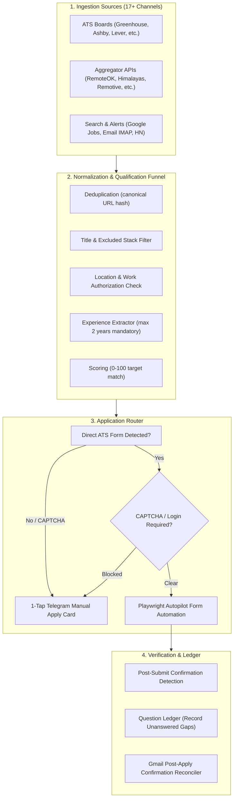

# Job Hunter 4.0.0 — Autonomous Career Autopilot

[](https://www.python.org/downloads/)
[](https://playwright.dev/)
[](tests/)
[](LICENSE)

Job Hunter is an explainable, autonomous job ingestion, qualification, and application pipeline tailored for early-career software engineers. It ingests thousands of listings across 17+ public channels and Applicant Tracking Systems (Greenhouse, Lever, Ashby, Workable, SmartRecruiters, Recruitee, BambooHR, Breezy HR, and more), evaluates strict eligibility (remote worldwide / Egypt, maximum 2 years mandatory experience), converts compensation dynamically across global currencies, and safely submits verified forms via an autonomous Playwright Chromium runner.

---

## 🧭 Documentation Index

For in-depth guides, architectural blueprints, and operational runbooks, see the [docs/](file:///run/media/hazalkoom/FD16124010E85459/job-hunter/Job-Seeker-push-20261019-121011/docs) directory:

| Document | Purpose |
|---|---|
| [**Architecture & Design**](file:///run/media/hazalkoom/FD16124010E85459/job-hunter/Job-Seeker-push-20261019-121011/docs/ARCHITECTURE.md) | Technical architecture, 7-stage pipeline diagram, SQLite schema, Playwright DOM engine, and safety invariants. |
| [**Features & Capabilities**](file:///run/media/hazalkoom/FD16124010E85459/job-hunter/Job-Seeker-push-20261019-121011/docs/FEATURES_AND_CAPABILITIES.md) | Exhaustive catalog of all 17 ingestion sources, qualification filters, multi-currency converter, and Question Ledger. |
| [**Getting Started & Setup**](file:///run/media/hazalkoom/FD16124010E85459/job-hunter/Job-Seeker-push-20261019-121011/docs/GETTING_STARTED.md) | Quickstart guide, local environment configuration, GPG secret encryption, and GitHub Actions workflow deployment. |
| [**Configuration Reference**](file:///run/media/hazalkoom/FD16124010E85459/job-hunter/Job-Seeker-push-20261019-121011/docs/CONFIGURATION_REFERENCE.md) | Comprehensive reference for all `.env` flags, candidate profile schemas, answer bank patterns, and ATS registries. |
| [**CLI Reference Toolkit**](file:///run/media/hazalkoom/FD16124010E85459/job-hunter/Job-Seeker-push-20261019-121011/docs/CLI_REFERENCE.md) | Complete guide for `python -m jobhunter` commands (`audit`, `sources`, `ats probe`, `form inspect`, `questions`, etc.). |
| [**Operations Runbook**](file:///run/media/hazalkoom/FD16124010E85459/job-hunter/Job-Seeker-push-20261019-121011/docs/OPERATIONS_RUNBOOK.md) | Daily schedule, Telegram notification templates, triage procedures for unanswered questions, and troubleshooting. |
| [**Autopilot Diagnostics**](file:///run/media/hazalkoom/FD16124010E85459/job-hunter/Job-Seeker-push-20261019-121011/docs/AUTOPILOT-DIAGNOSTICS.md) | Support bundle generator, audit log inspection, and sanitization guarantees. |
| [**Role-Tailored CV Generation**](file:///run/media/hazalkoom/FD16124010E85459/job-hunter/Job-Seeker-push-20261019-121011/docs/CV_GENERATION.md) | Automated generation of 29 role-tailored 1-page PDFs with clickable certificate, project, and open-source PR links. |

---

## ⚡ Key Highlights in Version 4.0.0

- **Multi-ATS Autonomous Playwright Engine**: Native, robust DOM interaction handlers for Greenhouse, Ashby (including CSS-based pseudo-asterisks and multi-step dialogs), Lever, Workable, SmartRecruiters, Recruitee, BambooHR, and Breezy HR.
- **Strict Safety Invariants**:
  - **Zero CAPTCHA Bypassing**: CAPTCHAs and Cloudflare challenges are immediately aborted with `captcha_detected` and forwarded to Telegram as 1-tap manual apply cards.
  - **Zero Hallucination**: Forms with unknown required fields are halted with `unanswered_required_questions` and staged into the Question Ledger.
  - **No Bot Login**: Never attempts automated login or cookie replay on LinkedIn, Indeed, or Wuzzuf; handles these via official email alert links.
- **7-Stage Qualification Funnel**: Filters out senior roles, irrelevancies, stale postings (>7 days), and mandatory professional experience requirements exceeding candidate limits.
- **Multi-Currency Dynamic Compensation**: Automatically translates 12,000 EGP/month base expectation into monthly/annual rates for USD ($222.44), EUR (€198.20), GBP (£165.35), or JPY (¥35,227).
- **Per-Skill Experience Matrix**: Fills exact years of experience for 13+ technologies (`python: 3`, `django: 2`, `fastapi: 1`, `javascript: 3`, `typescript: 2`, `angular: 2`, `react: 1`, `postgresql: 2`, `docker: 2`, `linux: 2`, `git: 2`, `qa: 1`, `kubernetes: 1`).
- **Interactive Question Ledger**: Automatically extracts unanswered form questions, deduplicates them, and stages them for quick user answer updates via `python -m jobhunter questions gaps`.
- **Integrated `jobhunter` CLI Toolkit**: Single unified CLI with 9 production subcommands for auditing, ATS probing, form inspection, and inbox reconciliation.

---

## 🏗️ High-Level Architecture



---

## 🚀 Quick Start (Local Setup)

### 1. Prerequisites
- Python 3.11 or 3.12
- Playwright Chromium browser binary

### 2. Installation
```bash
git clone https://github.com/hazalkoom/Job-Seeker-push-20261019-121011.git
cd Job-Seeker-push-20261019-121011

python3 -m venv .venv
source .venv/bin/activate
pip install --upgrade pip
pip install -r requirements.txt
playwright install chromium
```

### 3. Environment & Profile Setup
```bash
cp .env.example .env
# Edit .env and supply your credentials:
# TELEGRAM_BOT_TOKEN=...
# TELEGRAM_CHAT_ID=...
# AUTO_APPLY_ENABLED=false (start in dry-run mode!)
```

Decrypt your private candidate profile and answer bank:
```bash
gpg --decrypt private/candidate_profile.json.gpg > candidate_profile.json
gpg --decrypt private/application_answers.json.gpg > application_answers.json
gpg --decrypt private/Mohamed_Ahmed-general.pdf.gpg > private/Mohamed_Ahmed_CV.pdf
```

### 4. Running the Pipeline
Run an ingestion and qualification cycle in dry-run mode:
```bash
python main.py
```

Inspect funnel statistics and qualification outcomes:
```bash
python -m jobhunter audit funnel
```

---

## 🛠️ CLI Toolkit at a Glance

The unified CLI tool `jobhunter` provides complete observability and manual control:

```bash
# Audit recent funnel outcomes
python -m jobhunter audit funnel --hours 24

# Check health of all 17 ingestion sources
python -m jobhunter sources health

# Probe an employer's website to discover its ATS platform
python -m jobhunter ats probe https://linear.app/careers

# Discover new career boards for a specific ATS
python -m jobhunter ats discover ashby --query "software"

# Inspect and map form fields without submitting
python -m jobhunter form inspect https://jobs.ashbyhq.com/example/job-id

# Review questions that blocked applications
python -m jobhunter questions gaps

# Reconcile submitted applications against Gmail confirmation emails
python -m jobhunter inbox status --reconcile

# Generate a visual HTML report of all runs
python -m jobhunter report html --output run_report.html
```

---

## 🧪 Testing & Verification

The test suite validates 279 unit and integration tests across 23 modules, including full Playwright DOM interaction tests against local mock fixtures:

```bash
pytest -v
```

Output:
```text
======================= 279 passed in 43.14s =======================
```

---

## 🔒 Security & Privacy

1. **No Plaintext Secrets in Repository**: Candidate personal profile, answer banks, and CV PDFs are strictly git-ignored.
2. **Encrypted Remote Deployments**: Deployment to GitHub Actions uses GPG encrypted blobs with symmetric passphrases stored in repository secrets.
3. **Redacted Audit Logs**: Runtime execution logs scrub contact details, candidate names, and form input answers.

---

## 📄 License

This project is licensed under the [MIT License](LICENSE).
