# Job Hunter Architecture & Codebase Design

This document provides a comprehensive technical breakdown of **Job Hunter 4.0 Autopilot**: how it is engineered, the data flow, the design patterns, the matching logic, the multi-ATS headless automation engine, and the compliance invariants.

---

## 1. High-Level Architecture

Job Hunter is structured as a modular pipeline combining multi-source ingestion, explainable semantic classification, universal ATS routing, preflight verification, headless browser automation, and post-submission inbox reconciliation.

```mermaid
flowchart TD
    subgraph Ingestion["1. Ingestion Layer (app/sources/)"]
        A1["17+ Ingestion Sources<br/>(APIs, RSS, IMAP Alerts, HN, Crawlers)"]
    end

    subgraph Deduplication["2. Deduplication & Selection (app/runner.py, app/urls.py)"]
        B1["Canonical URL Normalization<br/>Evidence Ranking (Full > Summary > Meta)"]
    end

    subgraph Qualification["3. Qualification & Matching Engine (app/matching.py)"]
        C1["Title Filtering & Stack Exclusions<br/>(.NET, Ruby, PHP, Go, C++)"]
        C2["Language Fluency Gate<br/>(Reject Non-English Mandatory)"]
        C3["Experience Limit Check<br/>(≤ 2 yrs mandatory)"]
        C4["Location & Remote Eligibility<br/>(Cairo/Egypt on-site/remote; Worldwide/EMEA/Egypt-hiring)"]
        C5["Scoring Engine (0 - 100)<br/>Match / Review / Reject"]
    end

    subgraph Routing["4. Universal ATS Routing (app/ats_resolver.py)"]
        D1["Apply Path Classifier<br/>(direct_ats / login_gated / aggregator / custom)"]
        D2["ATS Resolver & Slug Probing<br/>(Greenhouse, Ashby, Lever, Workable, SmartRecruiters, etc.)"]
        D3["SerpAPI Fallback (Score ≥ 80, Capped at 3/run)"]
    end

    subgraph Queue["5. Queue & Prioritization (app/application_queue.py)"]
        E1["SQLite Queue (jobs, application_queue, events)"]
        E2["Queue Prioritization (Direct ATS First)"]
        E3["Company 30-Day Cap Check (Max 2 apps/employer)"]
    end

    subgraph Automation["6. Autonomous Form Automation (app/application_automation.py)"]
        F1["Preflight Verification (app/application_profile.py)"]
        F2["Playwright Headless Chromium Engine"]
        F3["Complex Widget Handlers<br/>(react-select, Ashby Yes/No, Checkbox groups)"]
        F4["Cookie Banner Interception (OneTrust/Workable)"]
        F5["Multi-Step Wizard Engine (Step 1 → Next → Submit)"]
        F6["PDF Cover Letter Generator (app/cover_letter.py)"]
        F7["Zero CAPTCHA Policy (Detect, Screenshot, Skip)"]
    end

    subgraph Telemetry["7. Telemetry & Reconciliation (app/funnel.py, app/sources/application_inbox.py)"]
        G1["7-Stage Funnel Telemetry Tracker"]
        G2["Question Ledger (SQLite + pending_questions.json)"]
        G3["Gmail IMAP Reconciler (Confirmations, Interviews, Rejections)"]
        G4["Telegram Bot Alerts & Digests"]
    end

    A1 --> B1
    B1 --> C1 --> C2 --> C3 --> C4 --> C5
    C5 --> D1
    D1 --> D2 --> D3
    D3 --> E1 --> E2 --> E3
    E3 --> F1 --> F2 --> F3 --> F4 --> F5 --> F6 --> F7
    F7 --> G1 --> G2 --> G3 --> G4
```

---

## 2. Core Modules & Code Map

The project is organized cleanly under [`app/`](../app), [`data/`](../data), [`jobhunter/`](../jobhunter), and [`tests/`](../tests):

| Path | Primary Purpose | Key Classes & Functions |
|---|---|---|
| [`app/models.py`](../app/models.py) | Data models | [`Job`](../app/models.py#L9-L43) dataclass (immutable representation of a posting) |
| [`app/config.py`](../app/config.py) | Environment & settings | [`Settings`](../app/config.py#L141-L229) dataclass loaded from `.env` |
| [`app/storage.py`](../app/storage.py) | SQLite database layer | [`init_db()`](../app/storage.py#L17-L135), [`upsert_job()`](../app/storage.py#L137-L215), [`mark_notified()`](../app/storage.py#L217-L230) |
| [`app/urls.py`](../app/urls.py) | URL normalization | [`canonical_job_url()`](../app/urls.py#L11-L47) (strips UTMs, tracking parameters, fragments) |
| [`app/matching.py`](../app/matching.py) | Qualification & eligibility engine | [`classify()`](../app/matching.py#L827-L1193), [`assess_experience()`](../app/matching.py#L715-L825), [`is_relevant_title()`](../app/matching.py#L23-L45) |
| [`app/ats_resolver.py`](../app/ats_resolver.py) | ATS discovery & routing | [`classify_apply_path()`](../app/ats_resolver.py#L67-L84), [`resolve_job_to_ats()`](../app/ats_resolver.py#L500-L570), [`extract_ats_from_url()`](../app/ats_resolver.py#L86-L114) |
| [`app/application_queue.py`](../app/application_queue.py) | Application state machine | [`enqueue_application()`](../app/application_queue.py#L76-L130), [`prioritize_queue_items()`](../app/application_queue.py#L589-L610), [`record_automation_outcome()`](../app/application_queue.py#L380-L460) |
| [`app/application_profile.py`](../app/application_profile.py) | Candidate facts resolver | [`load_profile_bundle()`](../app/application_profile.py#L132-L139), [`resolve_answer()`](../app/application_profile.py#L291-L680) |
| [`app/application_automation.py`](../app/application_automation.py) | Playwright form automator | [`run_auto_apply()`](../app/application_automation.py#L2100-L2327), [`_fill_form()`](../app/application_automation.py#L1505-L1745), [`_submit_step()`](../app/application_automation.py#L1700-L1747) |
| [`app/cover_letter.py`](../app/cover_letter.py) | Pure-Python PDF generator | [`generate_generic_cover_letter_pdf()`](../app/cover_letter.py#L101-L115), [`write_minimal_pdf()`](../app/cover_letter.py#L40-L99) |
| [`app/funnel.py`](../app/funnel.py) | Telemetry & Question Ledger | [`FunnelTracker`](../app/funnel.py#L31-L120), [`record_unanswered_question()`](../app/funnel.py#L130-L214) |
| [`app/runner.py`](../app/runner.py) | Main search & autopilot orchestrator | [`run_once()`](../app/runner.py#L174-L395), [`fetch_all()`](../app/runner.py#L36-L68) |
| [`app/telegram.py`](../app/telegram.py) | Telegram Bot integration | [`send_message()`](../app/telegram.py#L25-L60), [`format_message()`](../app/telegram.py#L62-L120) |
| [`app/jobhunter_cli.py`](../app/jobhunter_cli.py) | Diagnostic & operations CLI | `cmd_audit_funnel`, `cmd_sources_health`, `cmd_form_inspect`, `cmd_report_html` |
| [`app/tools/discover.py`](../app/tools/discover.py) | ATS scraper & endpoint prober | [`discover_from_url()`](../app/tools/discover.py#L86-L122), [`probe_ats_endpoint()`](../app/tools/discover.py#L42-L84) |

---

## 3. Database Schema (`jobs.sqlite3`)

The database uses SQLite with WAL mode and non-destructive migrations in `app/storage.py`:

### Table: `jobs`
Stores deduplicated job postings discovered across all sources.
- `id`: INTEGER PRIMARY KEY AUTOINCREMENT
- `source`: TEXT NOT NULL (e.g., `greenhouse:canonical`, `ashby:supabase`, `linkedin_alert`)
- `source_id`: TEXT NOT NULL
- `title`, `company`, `location`, `url`: TEXT
- `description`: TEXT NOT NULL
- `posted_at`: TEXT NOT NULL (ISO-8601 UTC timestamp)
- `date_kind`: TEXT NOT NULL (`posted`, `updated`, `unknown`)
- `remote`: INTEGER NOT NULL (0 or 1)
- `workplace_type`: TEXT (`remote`, `hybrid`, `onsite`, `unknown`)
- `employment_type`: TEXT (`Full-time`, `Contract`, `Internship`, etc.)
- `eligibility`: TEXT (structured location or timezone constraints)
- `description_quality`: TEXT (`full`, `summary`, `metadata`, `unknown`)
- `status`: TEXT (`match`, `review`, `reject`)
- `score`: INTEGER (0 to 100)
- `reasons`: TEXT (JSON array of qualifying evidence)
- `concerns`: TEXT (JSON array of review/rejection reasons)
- `first_seen_at`, `last_seen_at`: TEXT (ISO timestamps)
- `notified_at`: TEXT NULL (timestamp of Telegram notification)
- UNIQUE constraint: `(source, source_id)`

### Table: `application_queue`
Manages the application lifecycle for eligible postings.
- `id`: INTEGER PRIMARY KEY AUTOINCREMENT
- `job_id`: INTEGER NOT NULL (FK to `jobs.id`)
- `canonical_url`: TEXT NOT NULL UNIQUE
- `status`: TEXT NOT NULL (`pending_review`, `approved`, `ready`, `applying`, `submitted`, `auto_skipped`, `failed`)
- `qualification_status`: TEXT (`match` or `review`)
- `score`: INTEGER
- `reasons`, `concerns`: TEXT (JSON arrays)
- `preflight_status`: TEXT (`passed`, `failed`, `not_run`)
- `preflight_blockers`, `preflight_warnings`: TEXT (JSON arrays)
- `sightings_count`: INTEGER (tracks re-postings)
- `first_seen_at`, `last_seen_at`, `updated_at`: TEXT
- `reviewed_at`, `ready_at`, `submitted_at`: TEXT NULL
- `submission_reference`: TEXT (URL or confirmation token)
- `notes`: TEXT (explanation of outcome or skip reason)

### Table: `application_events`
Immutable audit log of all automation transitions.
- `id`: INTEGER PRIMARY KEY AUTOINCREMENT
- `queue_id`: INTEGER NOT NULL (FK to `application_queue.id`)
- `event_type`: TEXT NOT NULL (`enqueued`, `approved`, `preflight`, `attempt_started`, `attempt_finished`, `reconciled`)
- `details`: TEXT NOT NULL DEFAULT '{}' (redacted JSON details)
- `created_at`: TEXT NOT NULL

### Table: `question_ledger`
Collects unanswered required form questions discovered during headless automation.
- `id`: INTEGER PRIMARY KEY AUTOINCREMENT
- `normalized_key`: TEXT NOT NULL UNIQUE (e.g., `select:in which country do you currently work`)
- `question_text`: TEXT NOT NULL
- `field_type`: TEXT NOT NULL (`text`, `select`, `radio`, `checkbox`, `file`)
- `options_json`: TEXT (JSON array of dropdown/radio choices)
- `html_snippet`: TEXT (outer HTML of the field container for inspection)
- `company`: TEXT
- `ats_host`: TEXT
- `example_url`: TEXT
- `seen_count`: INTEGER NOT NULL DEFAULT 1
- `first_seen_at`, `last_seen_at`: TEXT NOT NULL
- `resolved`: INTEGER NOT NULL DEFAULT 0

---

## 4. The 7-Stage Conversion Funnel

Every run tracks postings across seven distinct stages to isolate bottlenecks:

1. **Fetched**: Raw listings retrieved from all enabled API, feed, and email sources.
2. **Title OK**: Passes negative title filters (no senior, staff, lead, principal, architect, or non-English titles).
3. **Qualified**: Matches tech stack and experience (≤ 2 yrs), passes hard exclusions, and meets the score floor (`60+`).
4. **Apply Path Known**: Classified as direct ATS form, login-gated board, or aggregator redirect.
5. **Resolved to ATS**: Successfully traced from an aggregator or email alert to the employer's hosted ATS page.
6. **Form Found & Filled**: Form controls located, cookie overlays dismissed, and required fields populated safely.
7. **Submitted & Confirmed**: Application confirmed via submit confirmation signals or verified through the candidate's Gmail inbox.

---

## 5. Autonomous Application Engine Design

### Headless Playwright Controller (`app/application_automation.py`)
- Launches headless Chromium with downloads disabled and a 30-second default timeout.
- Operates under strict rate limits (`AUTO_APPLY_DELAY_SECONDS=8`) and daily quotas (`AUTO_APPLY_MAX_PER_DAY=50`).
- Enforces an employer cap: max **2 applications per company within 30 rolling days**.

### Selector & Widget Architecture
Modern ATS platforms (Greenhouse React, Ashby, Workable) do not use simple `<form>` tags or standard HTML `<select>` elements. The automation engine resolves them dynamically:

1. **react-select Comboboxes**:
   - Locates `[class*='select__control']` or elements with `role='combobox'`.
   - Clicks to open, types the desired search term with keystroke delays, waits for asynchronous options to render, and selects the exact match (or presses `Enter`).
   - Verifies the selected value persisted in the control.

2. **Ashby CSS Asterisks & Field Containers**:
   - Ashby renders the required `*` marker via pseudo-elements (`::after`), leaving `innerText` free of asterisks.
   - The engine evaluates computed styles of `::after` and `::before` and inspects container classes (`[data-field-path]`, `.field-entry`) to detect required fields reliably.
   - Unlabeled inputs are mapped to their parent question title or hint description.

3. **Styled & Hidden Radios / Checkboxes**:
   - Workable and modern forms often hide the native `<input type='radio'>` behind customized SVG or `::before` labels.
   - The engine uses Playwright's force-checking and clicks the parent `<label>` element that a human user would click.

4. **Ashby Yes/No Button Groups**:
   - Found structurally (`button[data-option='yes']` / `button[data-option='no']`).
   - Answered from verified candidate facts (e.g., Cairo/Egypt location $\rightarrow$ `Yes`; Americas time zone $\rightarrow$ `No`; US/CET overlap $\rightarrow$ `Yes`).

5. **Multi-Step Wizards**:
   - Detects when clicking "Submit" or "Continue" advances to Step 2 without reloading the page.
   - Recursively inspects new controls, answers step 2 questions, and continues up to 3 additional steps.

6. **Cookie Banner Interception**:
   - Identifies OneTrust, Workable, and consent dialogs by container text and button labels.
   - Dismisses overlays before clicking or when pointer events are intercepted, ensuring terms dialogs are never blindly accepted.

7. **Pure-Python PDF Cover Letter Generation (`app/cover_letter.py`)**:
   - Generates valid `%PDF-1.4` documents dynamically without requiring heavy external binary tools (like WeasyPrint or wkhtmltopdf).
   - Tailors abstract, professional cover letters and attaches them when a file upload is required.

---

## 6. Safety & Compliance Invariants

1. **Zero CAPTCHA Solver / Bypass / Evasion**:
   - The system **never** uses third-party solving services (2Captcha, AntiCaptcha), browser-fingerprint spoofing, or stealth patches.
   - When a Cloudflare, hCaptcha, or reCAPTCHA challenge is encountered, it logs the selector, takes a screenshot (`logs/challenge_<id>.png`), records an `auto_skipped` outcome, and sends a 1-tap manual card to Telegram.

2. **Zero Guessing on Factual & Legal Claims**:
   - Required questions without a matching verified profile fact are marked as blockers.
   - The engine logs the field's question text, type, and HTML snippet to the Question Ledger and leaves the form untouched.

3. **Login-Gated Board Safeguards**:
   - LinkedIn, Indeed, Wuzzuf, and Glassdoor are **never** automated for login or scraping.
   - The system probes for the employer's public ATS posting; if none exists, it delivers a **1-tap Telegram manual apply card** containing direct links, suggested CVs, and pre-formatted answers.
